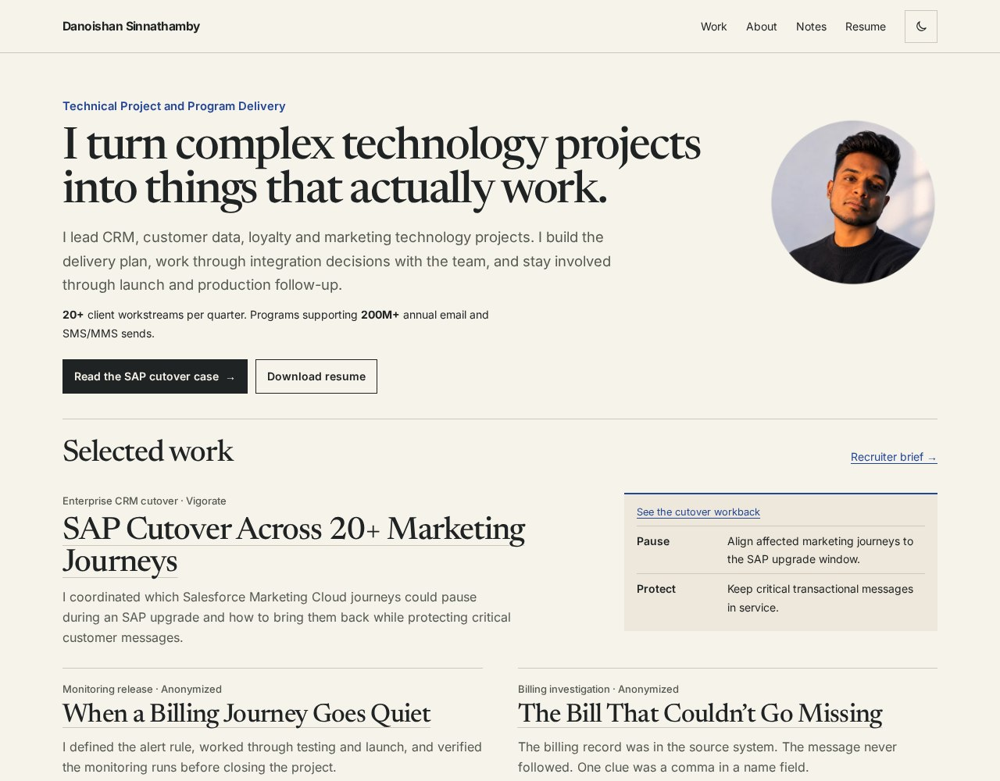

# Danoishan Sinnathamby: technical delivery portfolio

[Live portfolio](https://danoishan.github.io/) · [Recruiter brief](https://danoishan.github.io/brief.html) · [Resume](https://danoishan.github.io/resume.html) · [Runnable Waypoint exercise](https://danoishan.github.io/lab/waypoint-demo.html)

[](https://danoishan.github.io/)

I’m Dano, based in Hamilton, Ontario. At Vigorate I lead CRM, customer data, loyalty and marketing technology projects. I bring requirements to Solutions Consulting for scope and estimates, build the workback, lead testing and launch, and check how the release performs in production.

## Start here

| Evidence | What to inspect |
| --- | --- |
| [SAP Cutover Across 20+ Marketing Journeys](https://danoishan.github.io/work/200m-messages.html) | Workback for pausing and restarting affected journeys while protecting critical messages |
| [When a Billing Journey Goes Quiet](https://danoishan.github.io/work/billing-monitoring.html) | A weekly zero-send alert across eight journeys, from the rule to production verification |
| [One Offer, Many Versions](https://danoishan.github.io/work/creative-production.html) | The English file a partner retested and Dano cleared for scheduling in a bilingual production |
| [When Projects Share One Retainer](https://danoishan.github.io/work/retainer-priorities.html) | A program blueprint deferred while membership and billing work competed for approved capacity |
| [Recovering a Missed Journey Audience](https://danoishan.github.io/work/journey-recovery.html) | Approved one-time outreach and the separate routing change planned with developers |
| [The 80% Drop](https://danoishan.github.io/work/80-percent-drop.html) | An anonymized composite tracing why form submissions fell while traffic held up |
| [The Bill That Couldn’t Go Missing](https://danoishan.github.io/work/billing-journey.html) | The path from a billing file to a missing message, with a small CSV example |
| [From Brief to Testable Delivery](https://danoishan.github.io/work/ai-delivery-workflows.html) | A fictional before-and-after example of human-reviewed AI-assisted requirements |
| [Waypoint exercise](lab/waypoint-demo/) | Fictional policy engine, 19 scenarios, automated tests and recorded outputs |
| [Worked examples](https://danoishan.github.io/artifacts/#worked-example) | Sample audience decision and Waypoint validation results |
| [Templates](artifacts/templates/) | Reusable decision, handoff, readiness and validation tools |

## Run and validate

This is a static HTML/CSS/JavaScript site hosted on GitHub Pages. No package installation or build step is required. Use Python 3 and Node.js 20 or newer:

```sh
python3 -m http.server 8000
```

Open `http://localhost:8000`. In another terminal:

```sh
python3 scripts/check_site.py
node --test lab/waypoint-demo/test.mjs
node lab/waypoint-demo/run.mjs --check
```

The quality workflow runs those checks on changes. The existing GitHub Pages deployment handles publishing. Site structure: `work/` for cases, `lab/` for the fictional exercise, `artifacts/` for templates and filled examples, `notes/` for technical and operating notes. See [maintenance guidance](MAINTENANCE.md).

## Evidence and authorship

Career measures are reported work-history results. Underlying client records are not published. [Measurement context](https://danoishan.github.io/work/measurement-notes.html) explains definitions and limits. My official title and delivery function are stated separately; production implementation is credited to specialist functions.

Waypoint is original, AI-assisted portfolio work using synthetic data. Its results demonstrate a local model, not client impact, a live Braze integration or production throughput. Anonymized cases are not literal client implementation records.

## Reuse

Original site code, generic templates and fictional Waypoint examples are available under the scoped [MIT license](LICENSE.md). Personal resume content, career case prose, portrait / brand assets and third-party resources are excluded. Reuse the tools; do not present my career history as your own.
