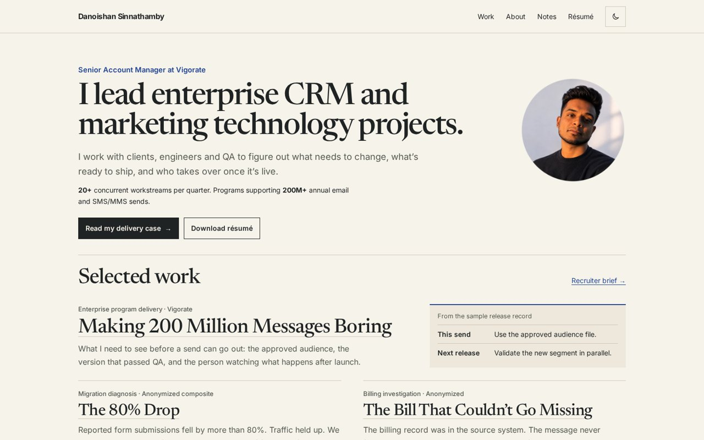

# Danoishan Sinnathamby: technical delivery portfolio

[Live portfolio](https://danoishan.github.io/) · [Résumé](https://danoishan.github.io/resume.html) · [Runnable Waypoint exercise](https://danoishan.github.io/lab/waypoint-demo.html)

[](https://danoishan.github.io/)

I’m a Senior Account Manager at Vigorate in Toronto. I lead enterprise CRM and marketing technology projects, from requirements and data handoffs through testing, release and follow-up.

## Start here

| Evidence | What to inspect |
| --- | --- |
| [Making 200 Million Messages Boring](https://danoishan.github.io/work/200m-messages.html) | Program delivery across 20+ concurrent workstreams per quarter, with a [sample audience decision record](artifacts/audience-release-record.md) |
| [The 80% Drop](https://danoishan.github.io/work/80-percent-drop.html) | An anonymized composite tracing why form submissions fell while traffic held up |
| [The Bill That Couldn’t Go Missing](https://danoishan.github.io/work/billing-journey.html) | The path from a billing file to a missing message, with a small CSV example |
| [One Offer, Many Versions](https://danoishan.github.io/work/creative-production.html) | Creative production and the bilingual email approval that had to follow the revised file |
| [From Brief to Testable Delivery](https://danoishan.github.io/work/ai-delivery-workflows.html) | A fictional before-and-after example of human-reviewed AI-assisted requirements |
| [Waypoint exercise](lab/waypoint-demo/) | Fictional policy engine, 18 scenarios, automated tests and recorded outputs |
| [Filled artifacts](artifacts/waypoint-decision-record.md) | A specific decision and matching [validation matrix](artifacts/waypoint-validation-matrix.md) |
| [Templates](artifacts/templates/) | Reusable decision, handoff, readiness and validation tools |

## Run and validate

This is a static HTML/CSS/JavaScript site hosted on GitHub Pages. No package installation or build step is required. Use Python 3 and Node.js 20 or newer:

```sh
python3 -m http.server 8000
```

Open `http://localhost:8000`. In another terminal:

```sh
python3 scripts/check_site.py
node --test lab/waypoint-demo/test.mjs
node lab/waypoint-demo/run.mjs --check
```

The quality workflow runs those checks on changes. The existing GitHub Pages deployment handles publishing. Site structure: `work/` for cases, `lab/` for the fictional exercise, `artifacts/` for templates and filled examples, `notes/` for technical and operating notes. See [maintenance guidance](MAINTENANCE.md).

## Evidence and authorship

Career measures are reported work-history results. Underlying client records are not published. [Measurement context](https://danoishan.github.io/work/measurement-notes.html) explains definitions and limits. My official title and delivery function are stated separately; production implementation is credited to specialist functions.

Waypoint is original, AI-assisted portfolio work using synthetic data. Its results demonstrate a local model, not client impact, a live Braze integration or production throughput. Anonymized cases are not literal client implementation records.

## Reuse

Original site code, generic templates and fictional Waypoint examples are available under the scoped [MIT license](LICENSE.md). Personal resume content, career case prose, portrait / brand assets and third-party resources are excluded. Reuse the tools; do not present my career history as your own.
